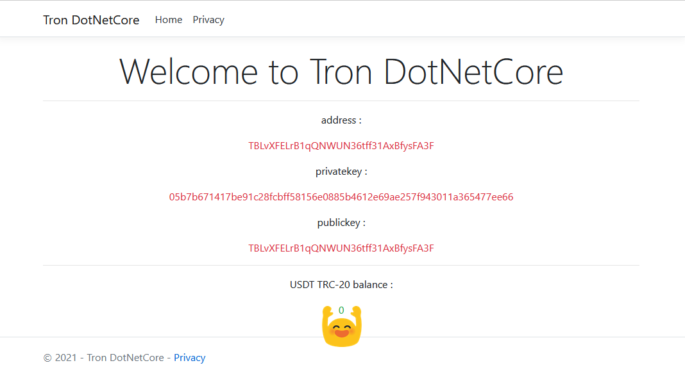

# Nexutron

A .NET 8 SDK for the TRON blockchain: key and address handling, building and signing TRX transfers,
TRC20 token balances and transfers, and typed gRPC clients for the full java-tron API
(`Nexutron.Protocol`). Cryptography and ABI encoding are built on [Nethereum](https://github.com/Nethereum/Nethereum) 7.

## Setup

```cs
IServiceCollection services = new ServiceCollection();
services.AddNexutron(x =>
{
    // TronGrid's public gRPC endpoints are plaintext, so UseTls = false.
    // Mainnet: grpc.trongrid.io:50051 / :50052, Nile testnet: grpc.nile.trongrid.io:50051 / :50061
    x.Channel = new GrpcChannelOption { Host = "grpc.trongrid.io", Port = 50051, UseTls = false };
    x.SolidityChannel = new GrpcChannelOption { Host = "grpc.trongrid.io", Port = 50052, UseTls = false };
    x.ApiKey = "your-trongrid-api-key"; // optional, https://www.trongrid.io/
});
var provider = services.BuildServiceProvider();
```

`GrpcChannelOption.UseTls` defaults to `true` (for nodes behind a TLS endpoint). Channels are created once and reused.

## Keys and addresses

```cs
var key = TronECKey.GenerateKey();          // random secp256k1 key
var address = key.GetPublicAddress();       // T... base58check address
var privateKey = key.GetPrivateKey();       // 64 hex chars

var account = new TronAccount(privateKey);  // or IWalletClient.GetAccount / GenerateAccount
var hex = AccountHelper.GetHexAddress(address);  // 41...
```

## TRX transfer

```cs
var transactions = provider.GetRequiredService<ITransactionClient>();

var amount = TronUnit.TRXToSun(2);  // 2 TRX = 2,000,000 sun
var created = await transactions.CreateTransactionAsync(account.Address, "TH8fU6BLpU6EjqvZTWWSB1uhpEVxzT35Xj", amount, "optional memo");
var signed = transactions.GetTransactionSign(created.Transaction, account.PrivateKey);
var result = await transactions.BroadcastTransactionAsync(signed);

Console.WriteLine($"{result.Result} {result.Code} txid={signed.GetTxid()}");
```

## TRC20 (e.g. USDT)

```cs
var trc20 = provider.GetRequiredService<IContractClientFactory>().CreateClient(ContractProtocol.TRC20);
const string usdt = "TR7NHqjeKQxGTCi8q8ZY4pL8otSzgjLj6t";

decimal balance = await trc20.BalanceOfAsync(usdt, account);

// Amounts are in whole tokens; decimals are read from the contract. feeLimit is in sun.
string txid = await trc20.TransferAsync(usdt, account, "TH8fU6BLpU6EjqvZTWWSB1uhpEVxzT35Xj", 12.5m, "memo", feeLimit: TronUnit.TRXToSun(30));
// txid is null if triggering or broadcasting failed (details are logged).
```

`TokenAmount.ToRaw` / `TokenAmount.FromRaw` convert exactly between token amounts and on-chain integers.

## Low level

`IWalletClient.GetWalletClient()` and `GetSolidityClient()` return the generated gRPC clients for every java-tron
API call; pass `IWalletClient.GetHeaders()` as headers to send the API key.

## Tests

```bash
dotnet test
```

The test suite checks addresses, transaction encoding, signatures and TRC20 ABI encoding against vectors
produced with TronWeb, and runs the clients end to end against an in-process gRPC Tron node.

`tests/Nexutron.LocalNode.Tests` runs the SDK against a real java-tron node on a private chain (Docker):
it deploys a TRC20 token and checks TRX and TRC20 transfers on chain. These tests are skipped unless
`NEXUTRON_LOCAL_NODE` is set:

```bash
./tests/local-node/start.sh
NEXUTRON_LOCAL_NODE=localhost dotnet test tests/Nexutron.LocalNode.Tests
```



## Credits

Nexutron is maintained by [Quantoz Technology](https://github.com/QuantozTechnology). It is based on
[TronDotNet](https://github.com/miladsoft/TronDotNet) and [TronNet](https://github.com/miladsoft/TronNet)
by Milad Raeisi ([@miladsoft](https://github.com/miladsoft)), released under the MIT License.
